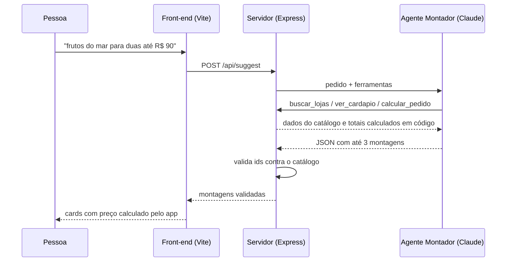

# Multicarrinho

Protótipo de produto para apps de delivery: **compare cardápios de várias lojas lado a lado** e peça montagens prontas a partir de uma frase, com um agente de IA (Claude) que consulta os cardápios reais e confere preços com ferramentas.

> Projeto conceitual de portfólio, não afiliado a nenhuma plataforma de delivery. Lojas, cardápios e preços são fictícios.

## A dor

Hoje o app de delivery aceita um carrinho por vez. Para saber quanto ficaria o mesmo pedido em outra loja, é preciso esvaziar o carrinho e montar tudo de novo. Quem compara desiste ou decide sem informação.

## A proposta

| Aba | O que faz |
|---|---|
| **Lojas** | Monta um *cardápio* em cada loja. Nenhum se perde ao trocar de loja. |
| **Monte pra mim** | A pessoa escreve "frutos do mar para duas até R$ 90" e o agente devolve até 3 montagens, uma por loja. |
| **Cardápios** | Compara os cardápios montados: total com entrega, tempo e selos de menor preço e mais rápido. |
| **Carrinho** | Continua único: uma loja por pedido, como no app atual. Só o cardápio escolhido vem para cá. |
| **Pedidos** | Após o pagamento simulado, o pedido aparece como confirmado e acompanha o status. |

O checkout não muda. Um pedido tem uma loja, um entregador e uma taxa, então a comparação acontece **antes** do carrinho.

## Como a IA entra



Três regras de projeto:

1. **A IA escolhe, o código calcula.** Preço, taxa e total vêm sempre de `shared/catalog.js`.
2. **Nada inventado chega à tela.** `shared/normalize.js` descarta lojas e itens que não existem no catálogo.
3. **Funciona sem IA.** Sem chave configurada, ou se a API falhar, um motor local de regras (`shared/local-engine.js`) gera as sugestões.

Detalhes em [docs/arquitetura.md](docs/arquitetura.md) e [docs/agentes.md](docs/agentes.md).

## Rodando localmente

Requisitos: Node.js 22 ou mais recente.

```bash
npm install
```

```bash
cp .env.example .env
```

Abra `.env` e cole sua chave em `ANTHROPIC_API_KEY` (crie uma em [console.anthropic.com](https://console.anthropic.com/)). Sem chave, o app roda com o motor local.

```bash
npm run dev
```

Acesse `http://localhost:5173`. O Vite serve a interface e repassa `/api` para o servidor na porta 3001.

Outros comandos:

```bash
npm test
```

```bash
npm run build && npm start
```

O segundo gera o build e sobe o servidor de produção em `http://localhost:3001`.

## Sobre a chave da API

- A chave fica **só no servidor**, na variável `ANTHROPIC_API_KEY`. O navegador nunca a recebe.
- `.env` está no `.gitignore`. Nunca faça commit da chave.
- O servidor limita pedidos por IP (`RATE_LIMIT_MAX`, padrão 20 a cada 10 minutos) para evitar uso abusivo quando o app estiver publicado.
- Modelo padrão: `claude-opus-5-5`. Para trocar, defina `CLAUDE_MODEL` no `.env`.
- Se o modelo recusar um pedido por política, a API tenta de novo num modelo de reserva (`fallbacks: "default"`).

## Publicando

Qualquer serviço que rode Node funciona (Render, Railway, Fly.io). Configure:

- Comando de build: `npm install && npm run build`
- Comando de início: `npm start`
- Variável de ambiente: `ANTHROPIC_API_KEY`

## Estrutura

```
├── data/stores.json          # catálogo fictício: 5 lojas, 37 itens
├── shared/                   # lógica pura usada pelo front-end e pelo servidor
│   ├── catalog.js            # preços, totais, porções
│   ├── local-engine.js       # motor de regras (reserva sem IA)
│   └── normalize.js          # valida a resposta da IA contra o catálogo
├── server/
│   ├── index.js              # Express: /api/health, /api/suggest, serve o build
│   └── agent/
│       ├── montador.js       # agente com Tool Runner do SDK da Anthropic
│       ├── tools.js          # ferramentas: buscar_lojas, ver_cardapio, calcular_pedido
│       └── prompt.js         # instruções do agente
├── src/                      # interface (JS puro + Vite)
│   ├── main.js               # estado, abas e eventos
│   ├── api.js                # chamadas ao servidor
│   └── styles.css
├── tests/                    # node:test
└── docs/                     # arquitetura, agentes, dados, pesquisas
```

## Pesquisas que sustentam a tese

Resumo em [docs/pesquisas.md](docs/pesquisas.md): meta-análise sobre excesso de opções (Chernev et al., 2015), o estudo das geleias (Iyengar e Lepper, 2000), a taxa média de abandono de carrinho (Baymard, 70,22%) e dados de comportamento em apps de delivery.

## Métricas para validar

- Taxa de conversão de carrinho em pedido
- Abandono de carrinho após troca de loja
- Tempo da abertura do app até o pedido
- Ticket médio e uso de "Monte pra mim"

## Licença

MIT
