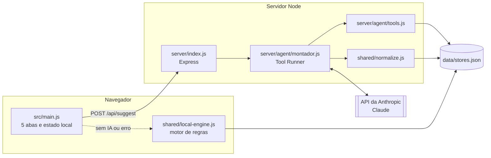

# Arquitetura

## Visão geral



## Camadas

| Camada | Onde | Responsabilidade |
|---|---|---|
| Dados | `data/stores.json` | Catálogo fictício. Fonte única de lojas, itens e preços. |
| Domínio | `shared/` | Funções puras: preço, porções, validação e motor local. Rodam no navegador e no servidor. |
| Agente | `server/agent/` | Interpreta o pedido, consulta o catálogo por ferramentas e devolve montagens em JSON. |
| API | `server/index.js` | Valida a entrada, limita pedidos por IP, trata erros da Anthropic e serve o build. |
| Interface | `src/` | Abas, cardápios, carrinho único, pagamento simulado e pedidos. Estado em `localStorage`. |

## Decisões

**A IA escolhe, o código calcula.** LLMs erram contas. O agente só decide *quais* itens; `priceLines` calcula tudo. A ferramenta `calcular_pedido` devolve o total ao agente para ele conferir o orçamento, mas o número exibido é recalculado pela interface.

**Validação na saída.** Mesmo com ferramentas, a resposta final passa por `normalizeSuggestions`: lojas e itens inexistentes são descartados, quantidades ficam entre 1 e 8 e no máximo 3 lojas aparecem.

**Degradação graciosa.** `/api/health` informa se há chave. Sem chave, com limite atingido ou com erro, a interface usa o motor local e avisa na conversa.

**Carrinho único preservado.** Cardápios (comparação) e Carrinho (pagamento) são estruturas separadas. O carrinho aceita uma loja; trocar de loja pede confirmação e devolve os itens anteriores para Cardápios.

**Sem framework no front-end.** O protótipo tem uma tela e estado simples; JS puro com Vite mantém o bundle em ~10 kB gzip e o código fácil de ler.

## Contrato da API

`GET /api/health`

```json
{ "ia": true, "modelo": "claude-opus-5-5" }
```

`POST /api/suggest`

```json
{
  "mensagem": "frutos do mar para duas até 70 reais",
  "historico": [{ "role": "user", "content": "..." }, { "role": "assistant", "content": "..." }]
}
```

Resposta:

```json
{
  "mensagem": "Montei 2 opções para vocês duas.",
  "sugestoes": [
    { "storeId": "sushi-cwb", "lines": [{ "id": "sc4", "qty": 1 }], "porque": "Combinado para dois no orçamento" }
  ],
  "fonte": "ia"
}
```

Erros: `400 mensagem_invalida`, `429 limite`, `502 api | recusado | resposta_invalida`, `503 ia_indisponivel | chave_invalida`.
